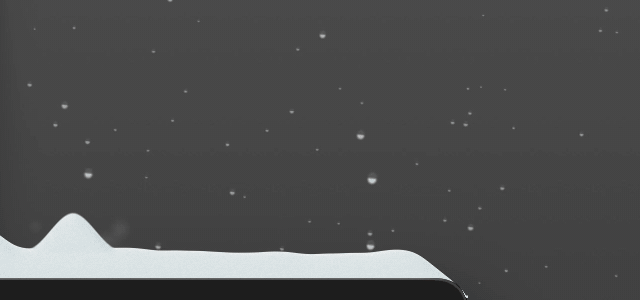
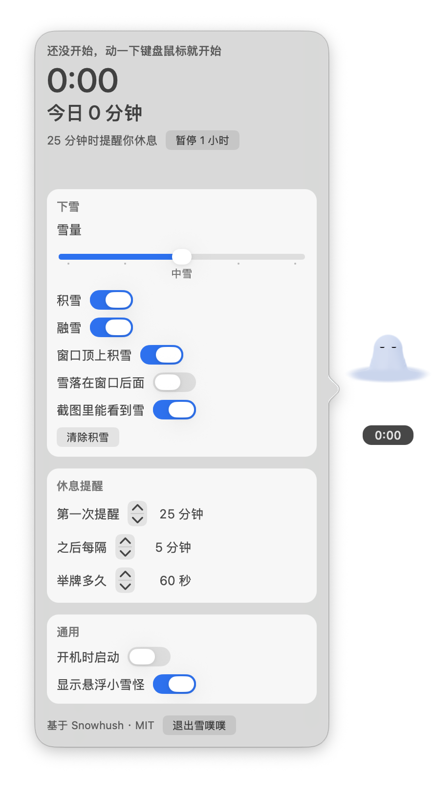
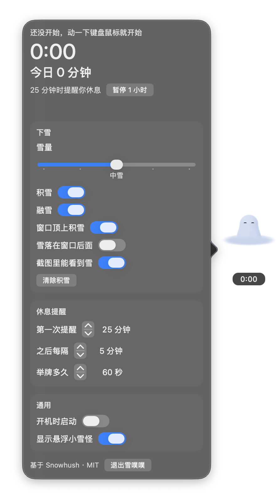

<p align="center">
  
</p>

<h1 align="center">雪噗噗 Snoob</h1>

<p align="center">
  住在你 Mac 桌面上的一团雪。你连续用电脑 25 分钟，<br>
  它就从窗口顶上的积雪里「噗」地冒出来，举起红牌子催你站起来。
</p>

<p align="center"><i>A little snow ghost for your Mac desktop. Work for 25 minutes straight and it pops out of the snow on your window and holds up a sign telling you to take a break.</i></p>

<p align="center">
  
</p>

> 目前只支持 **macOS 14 及以上**（Apple 芯片和 Intel 都行），界面是中文。需要从源码编译，步骤见下面「安装」。

## 它会做什么

**桌面一直在下雪。** 雪会积在屏幕底部、窗口顶上和程序坞上。鼠标扫过能把雪推开，拖动窗口顶上的雪会滑下来，关掉窗口雪会整块掉下来。这部分来自 [Snowhush](https://github.com/mbezruchko/Snowhush)，原样保留。

**你坐太久，它就出来。** 动一下键盘或鼠标，就开始计时。满 25 分钟，最前面那个窗口顶上的积雪会鼓成一团，雪噗噗冒出来，挥挥手，再抽出一块写着「25min」的红牌子，举 60 秒。你还没休息的话，之后每 5 分钟再举一次（30min、35min……）。

**碰它，它吓你；点它，它就散了。** 鼠标碰到它，它会举起爪子吓你一下，但不会散。点它一下，它散回雪里，这一轮计时清零，重新开始。要是点错了，10 秒内点「继续计时」就能撤销。

**它一直在角落看着你。** 屏幕右下角常驻一只悬浮的小雪噗噗，下面显示这一轮用了多久。没在计时的时候它闭眼打盹；计时中它睁着眼轻轻飘；该休息了还没休息，它就开始着急。按住可以拖到别处。

## 设置面板

点悬浮的雪噗噗或菜单栏的雪花，弹出同一块面板，跟着系统切换浅色和深色。

<p align="center">
  
  
</p>

| 分组 | 能调什么 |
|---|---|
| 顶部 | 这一轮的时长、今天累计用了多久（凌晨 4 点归零）、暂停提醒 1 小时 |
| 下雪 | 雪量（不下雪 / 小雪 / 中雪 / 大雪 / 时大时小）、积雪、融雪、窗口顶上积雪、雪落在窗口后面、截图里能看到雪、清除积雪 |
| 休息提醒 | 第一次提醒（默认 25 分钟）、之后每隔（默认 5 分钟）、举牌多久（默认 60 秒） |
| 通用 | 开机时启动、显示悬浮小雪怪 |

## 计时怎么算

| 发生了什么 | 计时怎么办 |
|---|---|
| 动了键盘或鼠标 | 开始一轮（开机、解锁、唤醒后的第一次输入都算） |
| 计时中 | 一直计，中途停下来不动也照样计 |
| 锁屏、电脑睡眠 | 这一轮结束，清零 |
| 点了举牌的雪噗噗 | 清零，马上开始新的一轮 |
| 它站着的窗口被拖走、最小化或关掉 | 它跟着雪一起掉下去，不算休息，不清零 |

它会尽量从最前面那个窗口的顶上冒出来，位置偏右，躲开左上角的红黄绿按钮。如果窗口贴着菜单栏，上面放不下它和牌子（大约要 100pt），它就改从屏幕右下角的积雪里冒出来。

计时和今日累计只存在你自己的 Mac 上。

## 安装

### 让 Agent 帮你装（推荐）

把这句话贴给 Claude Code、Codex 或别的能跑命令的 Agent：

```text
把 https://github.com/MengTang1114-open/m-snoob 装到我的 Mac 上，按仓库里的 AGENTS.md 编译、放进「应用程序」并打开。
```

### 自己装

需要 Xcode 或 Xcode 命令行工具（Swift 5.9 以上）。没有的话先跑 `xcode-select --install`。

```bash
git clone https://github.com/MengTang1114-open/m-snoob.git
cd m-snoob
./build.sh                       # 产物在 build/Snoob.app
cp -R build/Snoob.app /Applications/
open /Applications/Snoob.app
```

装了完整 Xcode 的话会编成 Apple 芯片和 Intel 通用的版本，只有命令行工具的话只编当前这台 Mac 的架构。

打开后它住在菜单栏里（雪花图标），程序坞里没有它。第一次打开会有一个欢迎窗口。

## 小提示

- **点雪噗噗时窗口全被推开了？** 这是 macOS「点按墙纸以显示桌面」把这一下也算成了点墙纸。打开「系统设置 → 桌面与程序坞」，把「点按墙纸以显示桌面」改成「仅在台前调度中」就好。我们还在修。
- **录屏、截图里看不到雪？** 默认雪不会出现在截图和屏幕共享里。想录下来，打开面板里的「截图里能看到雪」。
- **耗电。** 平时大约占一个 CPU 核心的 6%、65 MB 内存，和 Snowhush 差不多。只有举牌那一会儿，为了让牌子上的字清楚，那块屏会切成 Retina 分辨率，占用会高一点。
- **想退出。** 面板最下面「退出雪噗噗」。

## 开发

```bash
./build.sh                                 # 编译，产物 build/Snoob.app
IDENTITY="Developer ID Application: …" ./build.sh   # 用你的开发者证书签名
```

打包发布：`./release.sh <版本> --dry-run` 先在 `dist/` 里出一个 dmg 自己装一遍，没问题再 `./release.sh <版本> "这一版改了什么"` 发到 GitHub Release。有 Apple 开发者证书就自动签名、公证，没有就出未签名的包，用法写在脚本开头。

代码在 `Sources/Snowhush/`（Swift 目标名沿用上游，没改）。在 Snowhush 之上主要加了这几个文件：

| 文件 | 做什么 |
|---|---|
| `RestClock.swift` | 计时：一轮、今日累计、锁屏和睡眠清零、暂停、撤销 |
| `Reminder.swift` | 什么时候举牌、从哪个窗口顶上冒出来、接住点击 |
| `RestPanel.swift` | 悬浮的小雪噗噗和设置面板 |
| `GhostPortrait.swift` | 悬浮雪噗噗和 App 图标用的同一个形象 |

雪里冒出来的那只在 `Shaders.swift` 和 `SnowSimulation.swift` 里，是在 Snowhush 万圣节彩蛋的小幽灵上改的。App 图标用 `tools/render-icon.swift` 渲染，用法写在文件开头。

## 致谢和许可

雪的模拟、渲染和小幽灵的原型都来自 [Snowhush](https://github.com/mbezruchko/Snowhush)，作者 Mykhailo Bezruchko，MIT 许可。我们在它上面加了休息提醒、悬浮小雪噗噗和中文面板，去掉了万圣节的南瓜灯。

MIT，见 [LICENSE](LICENSE)。
